# Design: screens and connection flow

This is the reference design for how a user reaches a server from the ObjectOS app, and for the
native screens around the Console. It covers ObjectOS Cloud and private deployments. Cards link
here for layout and copy; the cards own the behaviour and acceptance.

- Images: [`connection-flow/`](./connection-flow/), rendered at 2× from the design canvas. Mockup
  copy is Chinese; the English strings below are the source for `locales/en.json`.
- Brand: the app and every user-visible string say **ObjectOS**. Technical identifiers such as
  `/.well-known/objectstack`, `@objectstack/*` and the `ObjectStackNative` bridge global stay as
  they are (mobile#151).
- Nouns: **organization** and **environment**, as in the Cloud console (cloud#2908). The app shows
  organizations and never shows a third noun such as "workspace".
- Release gate: mobile#150 (closed 2026-11-02).

## Overview

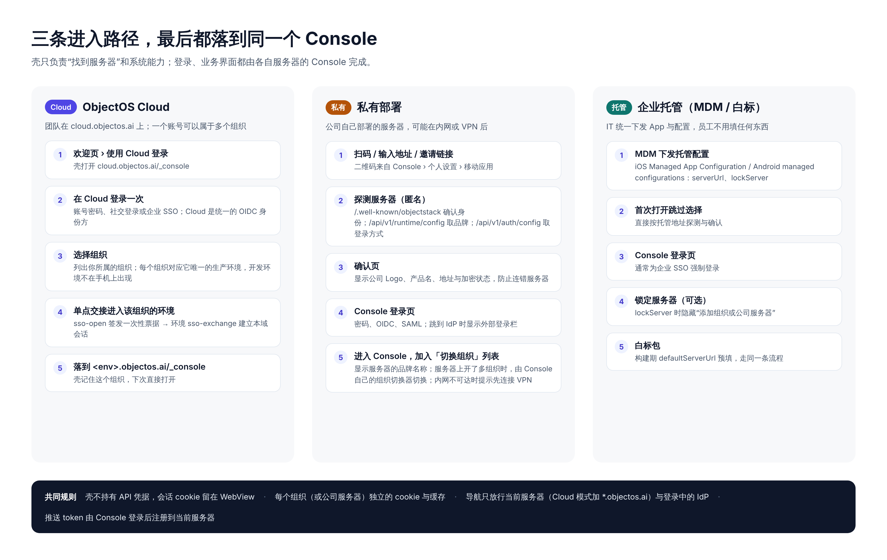

The shell finds the server and supplies system capabilities. Sign-in and business UI are always
the server's own Console.

| Path | Who | Steps |
|:--|:--|:--|
| **Cloud** | Teams on `cloud.objectos.ai`; one account can belong to several organizations | Welcome › Cloud → sign in once at Cloud (password, social, SSO; Cloud is the OIDC provider) → pick an organization → one-time handoff (`sso-open` → `sso-exchange`) → land on `<env>.objectos.ai/_console`; the shell remembers it |
| **Private** | A company's own server, possibly on an intranet or behind a VPN | Scan / enter address / invite link → anonymous probe → confirm screen → Console sign-in (password, OIDC, SAML; external sign-in bar on IdP pages) → Console; added to the switcher |
| **Managed** | IT distributes the app and its configuration | MDM managed configuration (`serverUrl`, `lockServer`) → skip the welcome screens → probe and confirm → Console sign-in, usually enforced SSO. White-label builds prefill `defaultServerUrl` at build time and follow the same flow |

Rules shared by every path:

- The shell holds no API credentials. The session cookie stays in the WebView.
- Each connection (organization or company server) has its own cookies and cache, isolated by
  host.
- The top frame admits only the current server, plus `cloud.<root>` and `*.<root>` in Cloud
  mode, plus an IdP during a sign-in excursion.
- The Console registers the push token with the current server after sign-in.

## Who renders each screen

| # | Screen | Renderer | Card |
|:--|:--|:--|:--|
| 1 | Welcome | Native | mobile#153, mobile#156 |
| 2 | Cloud: pick an organization | **Cloud console** in the WebView | cloud#3489 (page), mobile#153 (shell) |
| 3 | External sign-in bar | Native top bar; the form is the customer's IdP page | mobile#155 |
| 4 | Console (screenshot of the real Console, not a design) | **objectstack Console** in the WebView | objectstack#29039, objectstack#29040 |
| 5 | Private: enter address | Native | mobile#154 |
| 6 | Private: scan | Native | mobile#156 |
| 7 | Private: confirm server | Native | mobile#154 |
| 8 | Switch organization | Native bottom sheet | mobile#152 |
| 9 | Offline | Native | mobile#152 (secondary action) |
| 10 | Biometric lock | Native overlay | mobile#145 |

Supporting cards: mobile#151 (rebrand, scheme `objectos`, bundle id `ai.objectos.mobile`),
mobile#157 (MDM), mobile#158 (repository docs), mobile#159 (languages), objectstack#29314 (the
Console's Mobile app page that shows the connect QR code), cloud#3487 (the environment model; it
does not change these screens).

## Screens

### 1 Welcome (first launch)

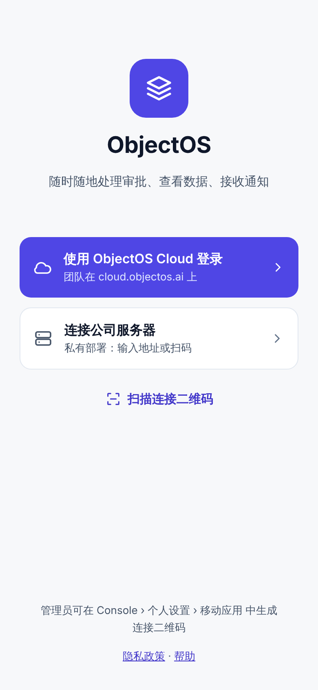

Shown when no connection is saved and no managed configuration is present.

| Element | zh | en |
|:--|:--|:--|
| Title | ObjectOS | ObjectOS |
| Subtitle | 随时随地处理审批、查看数据、接收通知 | Approve, look things up and get notified, wherever you are |
| Primary | 使用 ObjectOS Cloud 登录 / 团队在 cloud.objectos.ai 上 | Sign in with ObjectOS Cloud / Your team is on cloud.objectos.ai |
| Secondary | 连接公司服务器 / 私有部署：输入地址或扫码 | Connect to a company server / Private deployment: enter an address or scan |
| Tertiary | 扫描连接二维码 | Scan a connect QR code |
| Footnote | 管理员可在 Console › 个人设置 › 移动应用 中生成连接二维码 | Admins can create a connect QR code in Console › Personal settings › Mobile app |
| Links | 隐私政策 · 帮助 | Privacy policy · Help |

The primary button loads `<EXPO_PUBLIC_CLOUD_URL>/_console` (default `https://cloud.objectos.ai`).
The secondary goes to screen 5, the tertiary to screen 6.

### 2 Cloud: pick an organization

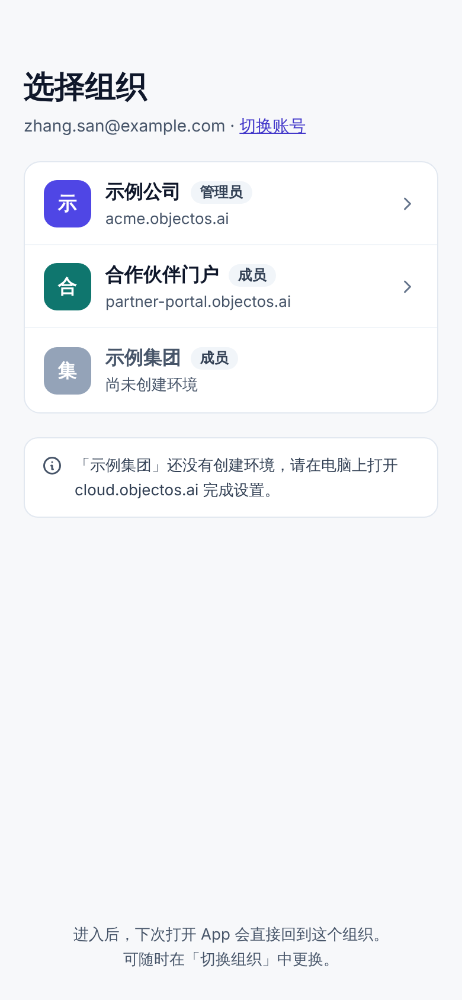

Rendered by the Cloud console, made phone-ready by cloud#3489. The shell adds no native picker.

- Header: 选择组织 / Choose an organization, with the signed-in account and 切换账号 / Switch
  account.
- Rows: organization name, the user's role, the environment host. Each organization opens its
  single production environment; development environments are not listed.
- An organization without an environment is shown disabled with: 「示例集团」还没有创建环境，请在电脑上打开
  cloud.objectos.ai 完成设置。 / "Example Group" has no environment yet. Open cloud.objectos.ai on a
  computer to finish setting it up.
- Footnote: 进入后，下次打开 App 会直接回到这个组织。可随时在「切换组织」中更换。 / Next time you open the
  app, it returns to this organization. Change it any time in Switch organization.

On landing at `https://<env>.<root>/_console…`, the shell saves the connection as kind `cloud` and
makes it current (mobile#153).

### 3 External sign-in bar

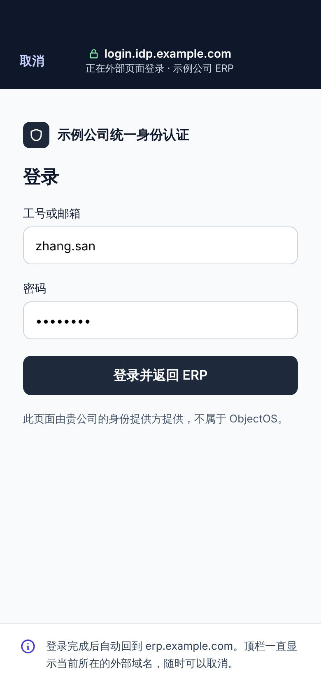

The page body is the customer's IdP; only the top bar is native.

- Top bar: 取消 / Cancel, a lock and the exact IdP host, and 正在外部页面登录 · <server label> /
  Signing in on an external page · <server label>.
- The excursion starts only from the server's sign-in surface (`/login`, `/api/v1/auth/*`), admits
  only `https:`, and ends when the WebView returns to the server's origin or the user cancels.
  Cancel returns to the server's `/login`.
- The bridge never answers an excursion page.
- IdPs that refuse embedded WebViews use the system auth session instead (mobile#148).

### 4 Console (shell mode)

| Landing (`/home`) | Navigation drawer | Record |
|:--:|:--:|:--:|
| 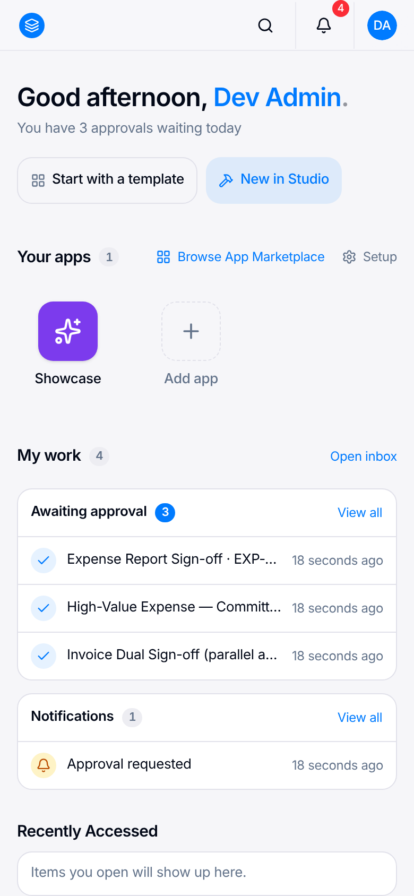 | 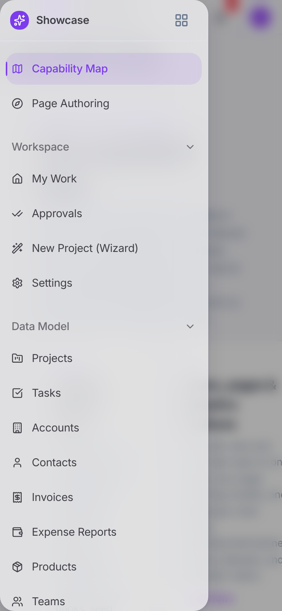 | 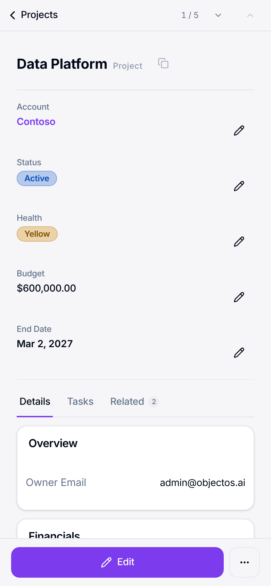 |

These are **screenshots of the real Console, not designs**. They were taken 2026-11-02 at 390×844
from the showcase example on objectstack `main` (2f7977cd), signed in, with
`window.ObjectStackNative` injected (`<html data-os-native-shell="ios">`). The shell draws nothing
here and adds no home page, tab bar or native navigation. Any change to this screen is a Console
card in objectstack-ai/objectstack, never a mobile card.

What the Console shows at phone width today:

- **Home (`/home`).**
  - The header has the product logo, search, the notification bell and the avatar menu (profile,
    organizations, theme, language, sign out).
  - The body has a greeting with the count of pending approvals, then **Your apps** (app tiles and
    Add app), **My work** (Awaiting approval, Notifications), Recently accessed and the activity
    feed.
- **Inside an app.**
  - A sidebar toggle opens a left drawer with the app's navigation. Its grid icon returns to
    `/home`, the app launcher.
  - Lists are cards with a floating create button.
- **Record.**
  - There is a back link with previous and next, then the fields, then tabs (Details, related
    lists).
  - The bottom bar holds record actions (Edit, …), not navigation.
- **No bottom tab bar anywhere.**

Where a signed-in user lands is the Console's own rule (`RootLandingRedirect` in
`ui/apps/console/src/components/RootLandingRedirect.tsx`):

1. the app marked `isDefault` → that app, at its first navigation item;
2. otherwise the only visible app → that app;
3. otherwise `/home`, the multi-app workspace (apps strip, action center, continue, activity).

The shell's only contributions are the safe-area padding around the WebView and, after
mobile#152, the switcher in screen 8: the Console's organization button opens it when
`ObjectStackNative.has('showConnectionSwitcher')` (consumer card filed after mobile#152 lands).

### 5 Private: enter address

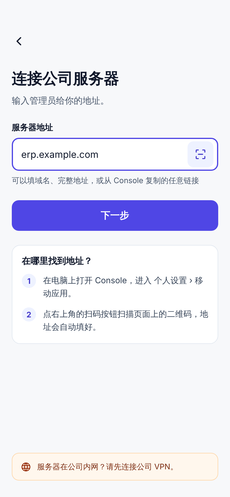

| Element | zh | en |
|:--|:--|:--|
| Title | 连接公司服务器 | Connect to a company server |
| Lead | 输入管理员给你的地址。 | Enter the address your admin gave you. |
| Field label | 服务器地址 | Server address |
| Field hint | 可以填域名、完整地址，或从 Console 复制的任意链接 | A domain, a full address, or any link copied from the Console |
| Action | 下一步 | Next |
| Help title | 在哪里找到地址？ | Where do I find the address? |
| Step 1 | 在电脑上打开 Console，进入 个人设置 › 移动应用。 | On a computer, open the Console and go to Personal settings › Mobile app. |
| Step 2 | 点右上角的扫码按钮扫描页面上的二维码，地址会自动填好。 | Tap the scan button at the top right and scan the code on that page; the address fills in. |
| VPN hint | 服务器在公司内网？请先连接公司 VPN。 | Server on your company network? Connect to the company VPN first. |

**Next** runs the anonymous probe (mobile#154):

1. `GET /.well-known/objectstack`: is this an ObjectOS server.
2. `GET /api/v1/runtime/config`: product name, logo, brand colour.
3. `GET /api/v1/auth/config`: sign-in methods, enforced SSO.

Errors, each with its own copy:

| Case | zh | en |
|:--|:--|:--|
| Unreachable | 无法连接到服务器。内网服务器请先连接 VPN。 | Can't reach the server. If it's on your company network, connect to the VPN first. |
| TLS failure | 证书无效 | The server's certificate isn't valid |
| Not ObjectOS | 这不是 ObjectOS 服务器 | This isn't an ObjectOS server |
| http on a public host | (existing copy) | (existing copy) |

### 6 Private: scan

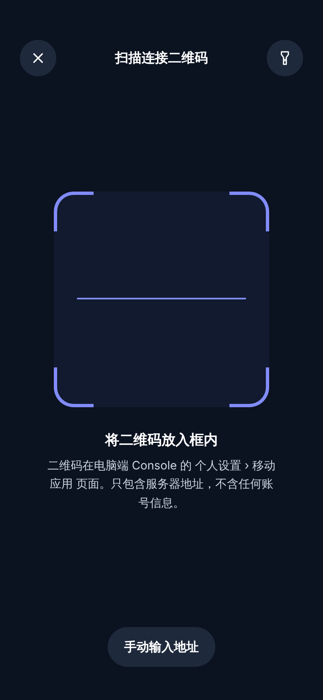

A native full-screen scanner with close and torch controls.

- Hint: 将二维码放入框内 / Fit the QR code inside the frame.
- Note: 二维码在电脑端 Console 的 个人设置 › 移动应用 页面。只包含服务器地址，不含任何账号信息。 / The code is on the
  Console's Personal settings › Mobile app page on a computer. It holds only the server address,
  never account details.
- Action: 手动输入地址 / Enter the address instead.
- Accepted codes: `objectos://connect?server=<url-encoded https URL>`, and a plain `https://` URL as
  a convenience. Anything else: 不是连接二维码 / This isn't a connect code.
- A scan never connects silently; it always goes to screen 7 (mobile#156). The same link works from
  an invite email.

### 7 Private: confirm server

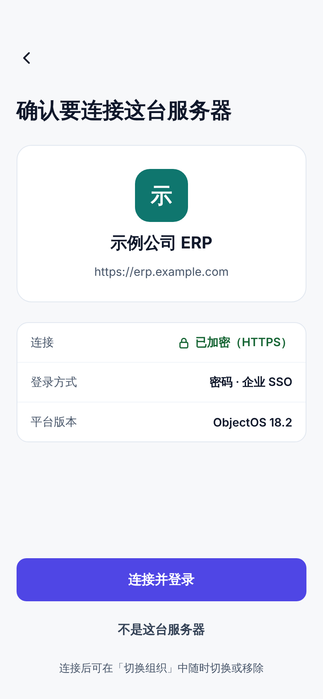

Protects against connecting to the wrong server. Nothing is saved until the user confirms.

| Element | zh | en |
|:--|:--|:--|
| Title | 确认要连接这台服务器 | Confirm this is the right server |
| Card | logo (or initial on the brand colour), product name, full URL | same |
| Row: connection | 已加密（HTTPS） (shown only for https) | Encrypted (HTTPS) |
| Row: sign-in | 登录方式 · e.g. 密码 · 企业 SSO | Sign-in · e.g. Password · Company SSO |
| Row: version | 平台版本 · ObjectOS <version> | Platform version · ObjectOS <version> |
| Primary | 连接并登录 | Connect and sign in |
| Secondary | 不是这台服务器 | Not this server |
| Footnote | 连接后可在「切换组织」中随时切换或移除 | After connecting, switch or remove it any time in Switch organization |

Missing branding falls back to the initial and a default colour.

### 8 Switch organization

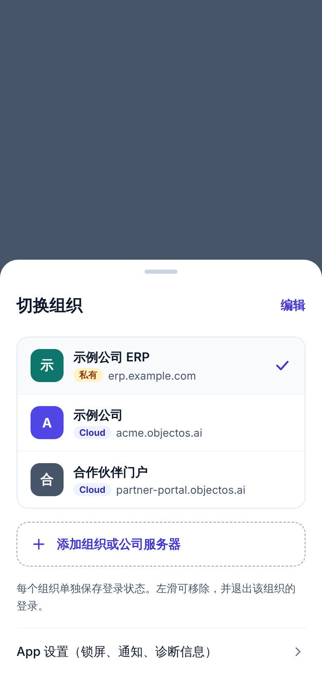

A native bottom sheet, opened from the Console header (bridge `showConnectionSwitcher()`) or from
screen 9 (mobile#152).

- Header: 切换组织 / Switch organization, with 编辑 / Edit.
- Rows: initial on the brand colour, label, host, a kind badge (Cloud / 私有 · Private), and a check
  on the current connection.
- 添加组织或公司服务器 / Add an organization or company server → screen 1 (hidden when MDM sets
  `lockServer`, mobile#157).
- Footnote: 每个组织单独保存登录状态。左滑可移除，并退出该组织的登录。 / Each organization keeps its own
  sign-in. Swipe left to remove one and sign out of it.
- Link: App 设置（锁屏、通知、诊断信息） / App settings (lock, notifications, diagnostics).

Switching remounts the WebView on the chosen host at that connection's last route. Removing clears
that host's cookies and unregisters its push token when possible.

### 9 Offline

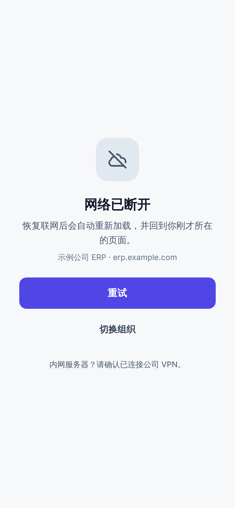

| Element | zh | en |
|:--|:--|:--|
| Title | 网络已断开 | You're offline |
| Body | 恢复联网后会自动重新加载，并回到你刚才所在的页面。 | When you're back online, the page reloads and returns to where you were. |
| Context | <label> · <host> | <label> · <host> |
| Primary | 重试 | Try again |
| Secondary | 切换组织 | Switch organization |
| Hint | 内网服务器？请确认已连接公司 VPN。 | Company-network server? Check that you're connected to the VPN. |

### 10 Biometric lock

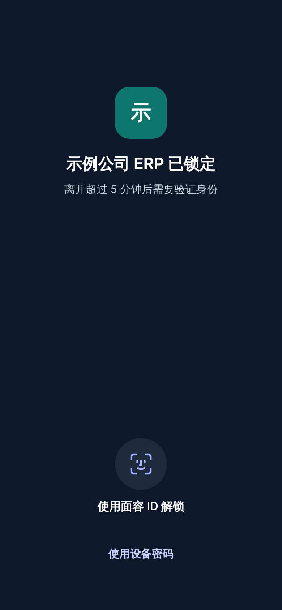

A native overlay above a still-mounted WebView (mobile#145).

| Element | zh | en |
|:--|:--|:--|
| Title | <label> 已锁定 | <label> is locked |
| Body | 离开超过 5 分钟后需要验证身份 | After 5 minutes away, confirm it's you |
| Primary | 使用面容 ID 解锁 (per platform: 触控 ID / 指纹) | Unlock with Face ID (per platform: Touch ID / fingerprint) |
| Secondary | 使用设备密码 | Use device passcode |

The timeout in the body follows the user's setting.

## Languages and layout

Every native string ships in the platform's 11 languages (en, zh-Hans, zh-Hant, es, ar, fr, pt-BR,
ru, de, ja, ko; the table is objectstack-ai/objectstack#29428) and follows the phone's language;
Arabic lays out right-to-left (mobile#159, mobile#182). The zh column above is zh-Hans; zh-Hant is
converted from it, and the other eight are translations of the en column.

## Updating this design

Change the copy here and in `locales/` in the same PR. Re-render an image when its layout changes;
otherwise a copy change does not require a new image.
